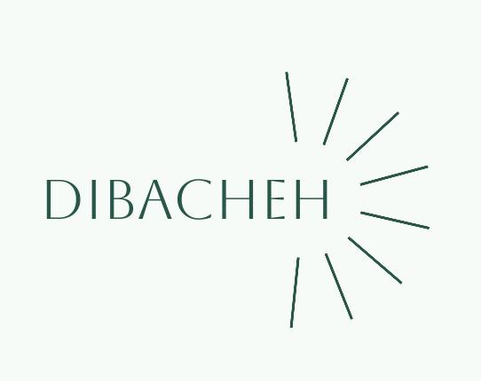

# Dibacheh

[English](README.md) · [فارسی](README.fa.md) · [简体中文](README.zh.md) · [Español](README.es.md) · [العربية](README.ar.md) · [हिन्दी](README.hi.md) · [Português](README.pt.md) · [Français](README.fr.md) · [Русский](README.ru.md) · [Bahasa Indonesia](README.id.md) · [Deutsch](README.de.md) · [Türkçe](README.tr.md) · [日本語](README.ja.md)

Dibacheh ist ein Offline-Lernplaner. Er teilt jede Lektion in Einheiten, plant Wiederholungen nach der Leitner-Methode und ordnet den ganzen Plan nach jeder Änderung neu. Ihre Daten bleiben auf Ihrem Computer.

## Funktionen

- Plan nach Tag, Woche, Monat oder komplett bis zur letzten Wiederholung, vertikal oder horizontal
- „+“-Menü: Lektion, Routine, einmalige Aufgabe, Projekt, eigene Typen und fertige Vorlagen
- Leitner-Wiederholungen mit einstellbaren Abständen oder gar keine für eine Lektion
- Berichte mit Wochen- und Monatsnote
- HTML-Export zum Offline-Lesen auf dem Handy
- Tägliches Backup, auch in Ihrem OneDrive-, Google-Drive-, Dropbox- oder iCloud-Ordner
- Mehrere Benutzer auf einem Computer, mit getrennten Daten, Foto oder fertigem Bild und optionalem Passwort
- 13 Sprachen, Solar-Hidschri- und gregorianischer Kalender, heller und dunkler Modus, Größen von 50 % bis 200 %

## Download

**[Neueste Version herunterladen](https://github.com/sdmjrfp/Dibacheh/releases/latest)**. Python oder andere Software müssen Sie nicht installieren.

| System | Datei |
|---|---|
| Mac mit Apple-Chip | `…-AppleSilicon.dmg` |
| Intel-Mac | `…-Intel.dmg` |
| Windows 10 und 11 | `…-Windows-Setup.exe` |
| Linux (x86_64) | `…-Linux-x86_64.AppImage` |

Das Programm hat keine bezahlte Signatur, daher warnt das System beim ersten Start. Auf dem Mac: Systemeinstellungen, Datenschutz & Sicherheit, Trotzdem öffnen. Unter Windows: Weitere Informationen, Trotzdem ausführen.

Das Programm geht nur online, um im Hintergrund nach einer neuen Version zu sehen. Das lässt sich in den Einstellungen abschalten; es werden keine Daten gesendet.

Diese Datei und die Übersetzungen des Programms wurden von einer KI geschrieben und nicht von einem Menschen geprüft.

Kostenlos für den persönlichen Gebrauch; siehe [LICENSE](LICENSE).
