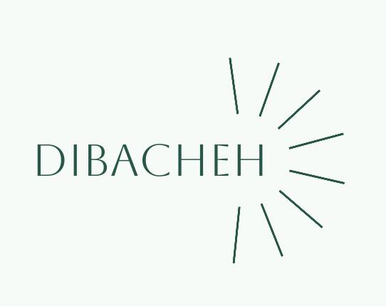

# Dibacheh

[English](README.md) · [فارسی](README.fa.md) · [简体中文](README.zh.md) · [Español](README.es.md) · [العربية](README.ar.md) · [हिन्दी](README.hi.md) · [Português](README.pt.md) · [Français](README.fr.md) · [Русский](README.ru.md) · [Bahasa Indonesia](README.id.md) · [Deutsch](README.de.md) · [Türkçe](README.tr.md) · [日本語](README.ja.md)

Dibacheh est un planificateur d'études hors ligne. Il découpe chaque leçon en séances, programme les révisions avec la méthode de Leitner et réorganise tout le plan après chaque changement. Vos données restent sur votre ordinateur.

## Fonctions

- Plan par jour, semaine, mois ou complet jusqu'à la dernière révision, vertical ou horizontal
- Menu « + » : leçon, routine, tâche unique, projet, vos types et des modèles prêts à l'emploi
- Révisions de Leitner à intervalles réglables, ou aucune pour une leçon
- Rapports avec note hebdomadaire et mensuelle
- Export HTML à lire hors ligne sur le téléphone
- Sauvegarde quotidienne, aussi copiée dans votre dossier OneDrive, Google Drive, Dropbox ou iCloud
- Plusieurs utilisateurs sur un ordinateur, avec données séparées, photo ou image prête et mot de passe facultatif
- 13 langues, calendrier hégirien solaire et grégorien, mode clair et sombre, tailles de 50 % à 200 %

## Téléchargement

**[Télécharger la dernière version](https://github.com/sdmjrfp/Dibacheh/releases/latest)**. Inutile d'installer Python ou autre chose.

| Système | Fichier |
|---|---|
| Mac avec puce Apple | `…-AppleSilicon.dmg` |
| Mac Intel | `…-Intel.dmg` |
| Windows 10 et 11 | `…-Windows-Setup.exe` |
| Linux (x86_64) | `…-Linux-x86_64.AppImage` |

L'application n'a pas de signature payante, le système avertit donc la première fois. Sur Mac : Réglages Système, Confidentialité et sécurité, Ouvrir quand même. Sur Windows : Informations complémentaires, Exécuter quand même.

L'application ne se connecte que pour vérifier en arrière-plan s'il existe une nouvelle version. Cela se désactive dans les Paramètres et aucune donnée n'est envoyée.

Ce fichier et les traductions de l'application ont été écrits par une IA et n'ont pas été relus par une personne.

Gratuit pour un usage personnel ; voir [LICENSE](LICENSE).
