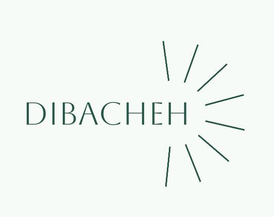

# Dibacheh

[English](README.md) · [فارسی](README.fa.md) · [简体中文](README.zh.md) · [Español](README.es.md) · [العربية](README.ar.md) · [हिन्दी](README.hi.md) · [Português](README.pt.md) · [Français](README.fr.md) · [Русский](README.ru.md) · [Bahasa Indonesia](README.id.md) · [Deutsch](README.de.md) · [Türkçe](README.tr.md) · [日本語](README.ja.md)

Dibacheh — офлайн-планировщик учёбы. Он делит каждый урок на занятия, назначает повторения по методу Лейтнера и перестраивает весь план после каждого изменения. Ваши данные остаются на вашем компьютере.

## Возможности

- План по дням, неделям, месяцам или целиком до последнего повторения, вертикально или горизонтально
- Меню «+»: урок, рутина, разовая задача, проект, свои типы и готовые шаблоны
- Повторения по Лейтнеру с настраиваемыми интервалами или вовсе без них для урока
- Отчёты с оценкой за неделю и месяц
- Экспорт в HTML для чтения на телефоне без интернета
- Ежедневная резервная копия, в том числе в папку OneDrive, Google Drive, Dropbox или iCloud
- Несколько пользователей на одном компьютере: отдельные данные, фото или готовая картинка и необязательный пароль
- 13 языков, солнечная хиджра и григорианский календарь, светлая и тёмная темы, размер от 50% до 200%

## Загрузка

**[Скачать последнюю версию](https://github.com/sdmjrfp/Dibacheh/releases/latest)**. Устанавливать Python или что-либо ещё не нужно.

| Система | Файл |
|---|---|
| Mac с чипом Apple | `…-AppleSilicon.dmg` |
| Mac с Intel | `…-Intel.dmg` |
| Windows 10 и 11 | `…-Windows-Setup.exe` |
| Linux (x86_64) | `…-Linux-x86_64.AppImage` |

У программы нет платной подписи, поэтому система предупредит при первом запуске. На Mac: Системные настройки, Конфиденциальность и безопасность, Всё равно открыть. В Windows: Подробнее, Выполнить в любом случае.

Программа выходит в интернет только для фоновой проверки новой версии. Это можно отключить в настройках, ваши данные не отправляются.

Этот файл и переводы программы написаны ИИ и не проверялись человеком.

Бесплатно для личного использования; см. [LICENSE](LICENSE).
