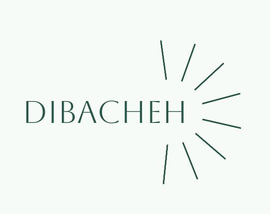

# Dibacheh

[English](README.md) · [فارسی](README.fa.md) · [简体中文](README.zh.md) · [Español](README.es.md) · [العربية](README.ar.md) · [हिन्दी](README.hi.md) · [Português](README.pt.md) · [Français](README.fr.md) · [Русский](README.ru.md) · [Bahasa Indonesia](README.id.md) · [Deutsch](README.de.md) · [Türkçe](README.tr.md) · [日本語](README.ja.md)

Dibacheh çevrimdışı bir çalışma planlayıcısıdır. Her dersi oturumlara böler, tekrarları Leitner yöntemiyle planlar ve her değişiklikten sonra tüm planı yeniden düzenler. Verileriniz bilgisayarınızda kalır.

## Özellikler

- Günlük, haftalık, aylık veya son tekrara kadar tüm plan; dikey ya da yatay
- "+" menüsü: ders, rutin, tek seferlik görev, proje, kendi türleriniz ve hazır şablonlar
- Ayarlanabilir aralıklı Leitner tekrarları ya da bir ders için hiç tekrar yok
- Haftalık ve aylık puanlı raporlar
- Telefonda çevrimdışı okumak için HTML dışa aktarımı
- Günlük yedek, ayrıca OneDrive, Google Drive, Dropbox veya iCloud klasörünüze kopyalanır
- Bir bilgisayarda birkaç kullanıcı: ayrı veriler, fotoğraf veya hazır resim ve isteğe bağlı parola
- 13 dil, Hicri Şemsi ve Miladi takvim, açık ve koyu mod, %50 ile %200 arası boyut

## İndirme

**[En son sürümü indirin](https://github.com/sdmjrfp/Dibacheh/releases/latest)**. Python veya başka bir şey kurmanız gerekmez.

| Sistem | Dosya |
|---|---|
| Apple çipli Mac | `…-AppleSilicon.dmg` |
| Intel Mac | `…-Intel.dmg` |
| Windows 10 ve 11 | `…-Windows-Setup.exe` |
| Linux (x86_64) | `…-Linux-x86_64.AppImage` |

Uygulamanın ücretli imzası yok, bu yüzden sistem ilk seferde uyarır. Mac'te: Sistem Ayarları, Gizlilik ve Güvenlik, Yine de Aç. Windows'ta: Ek bilgi, Yine de çalıştır.

Uygulama yalnızca arka planda yeni sürüm denetlemek için internete bağlanır. Bu Ayarlar'dan kapatılabilir ve verileriniz gönderilmez.

Bu dosya ve uygulamanın çevirileri yapay zekâ tarafından yazıldı, bir insan tarafından gözden geçirilmedi.

Kişisel kullanım için ücretsizdir; bkz. [LICENSE](LICENSE).
